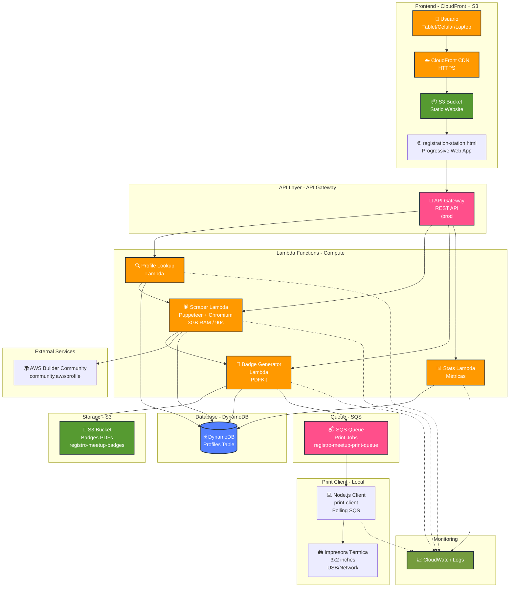
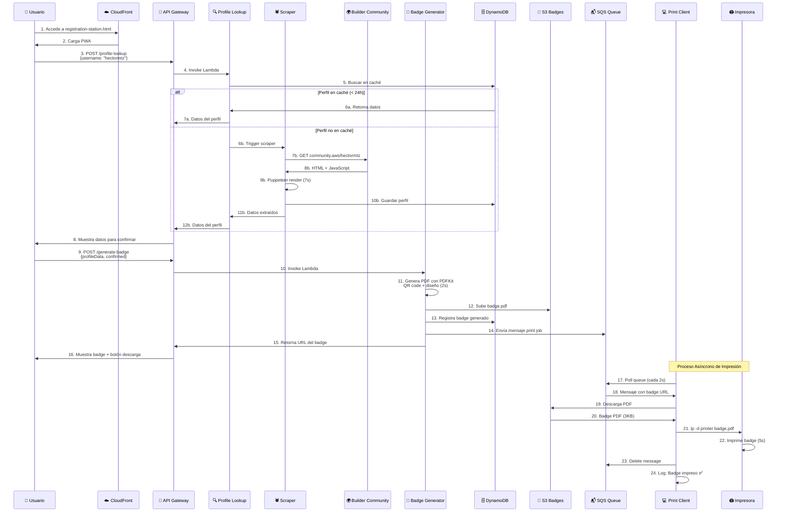
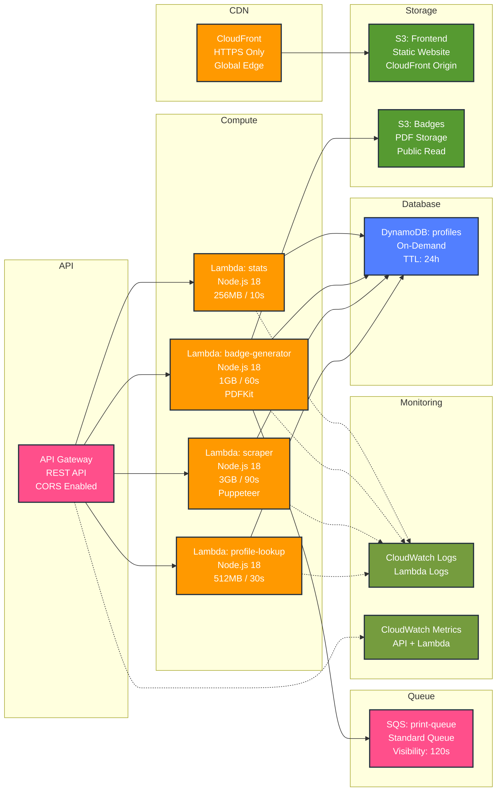
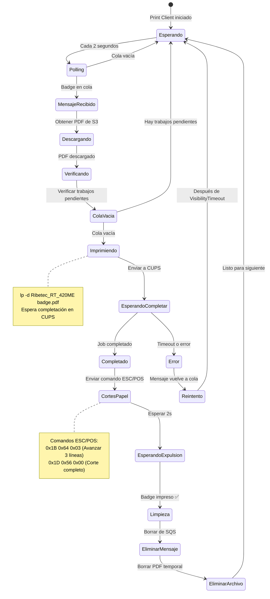
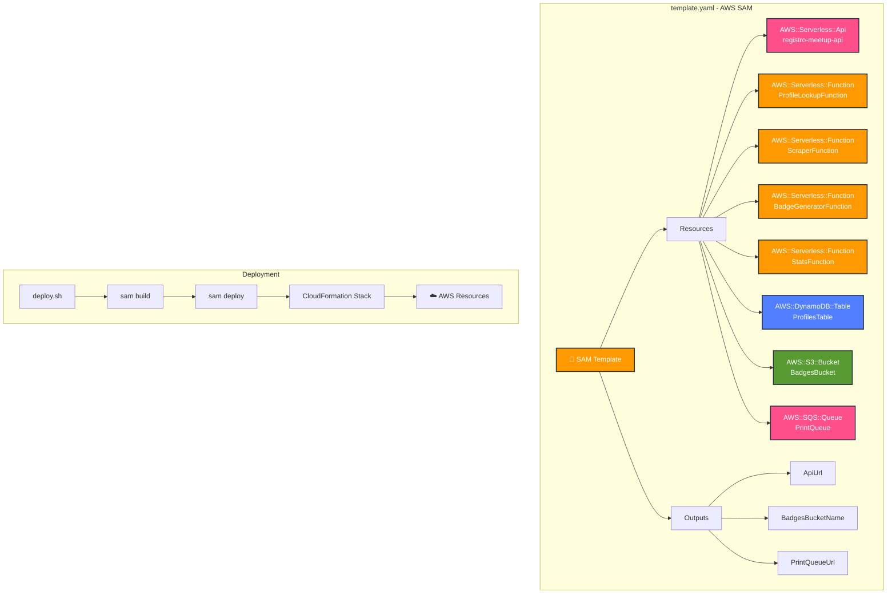
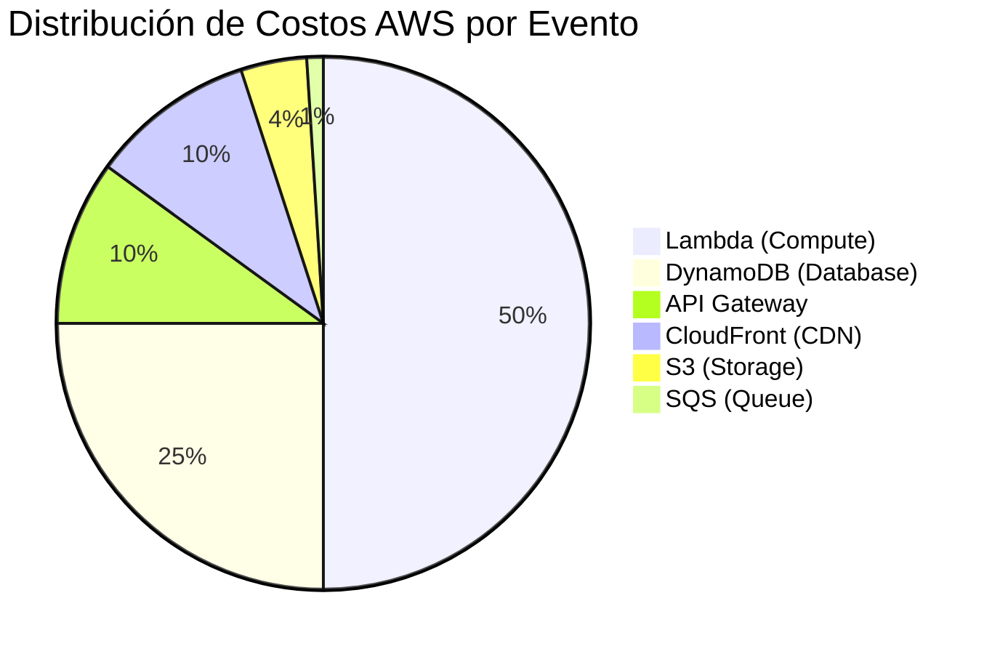

# Diagrama de Arquitectura - Sistema de Registro Automático para Meetups

## Arquitectura Completa



## Flujo de Datos Detallado



## Componentes por Servicio AWS



## Flujo de Impresión Detallado



## Infraestructura como Código (SAM)



## Costos por Componente (100 asistentes/evento)



## Métricas de Performance

```mermaid
gantt
    title Tiempo de Procesamiento por Badge
    dateFormat  s
    axisFormat %Ss

    section Extracción
    Scraper Lambda (Builder Community)    :a1, 0, 7s
    
    section Generación
    Badge Generator (PDF + QR)            :a2, after a1, 2s
    
    section Impresión
    Download PDF                          :a3, after a2, 1s
    Print Job (CUPS)                      :a4, after a3, 2s
    
    section Total
    Tiempo Total                          :milestone, after a4, 0s
```



---

## Cómo Usar estos Diagramas

### En GitHub/GitLab
Los diagramas Mermaid se renderizan automáticamente en archivos `.md`

### Convertir a Imagen
```bash
# Opción 1: Usar mermaid-cli
npm install -g @mermaid-js/mermaid-cli
mmdc -i ARQUITECTURA_DIAGRAMA.md -o arquitectura.png

# Opción 2: Usar editor online
# https://mermaid.live/
```

### En Presentaciones
1. Copiar código Mermaid
2. Pegar en https://mermaid.live/
3. Exportar como PNG/SVG
4. Insertar en PowerPoint/Keynote

### En Documentación
Incluir directamente en Markdown - se renderiza automáticamente en:
- GitHub
- GitLab
- Notion
- Confluence (con plugin)
- VS Code (con extensión)

---

## Leyenda de Colores

- 🟠 **Naranja (#FF9900)**: Servicios de Compute (Lambda, CloudFront)
- 🟢 **Verde (#569A31)**: Servicios de Storage (S3)
- 🔵 **Azul (#527FFF)**: Servicios de Database (DynamoDB)
- 🔴 **Rosa (#FF4F8B)**: Servicios de API/Queue (API Gateway, SQS)
- 🟤 **Verde Oliva (#759C3E)**: Servicios de Monitoring (CloudWatch)

---

## Arquitectura de Referencia AWS

Este diseño sigue las mejores prácticas de AWS Well-Architected Framework:

✅ **Operational Excellence**: CloudWatch Logs, métricas, automatización
✅ **Security**: IAM roles, HTTPS, CORS, validación
✅ **Reliability**: Serverless auto-scaling, SQS para resiliencia
✅ **Performance Efficiency**: Lambda optimizado, CloudFront CDN
✅ **Cost Optimization**: On-demand pricing, ~$1 por evento
✅ **Sustainability**: Serverless = sin servidores idle

---

**Creado para AWS User Group Monterrey**
*Sistema de Registro Automático con AWS Builder Community*
