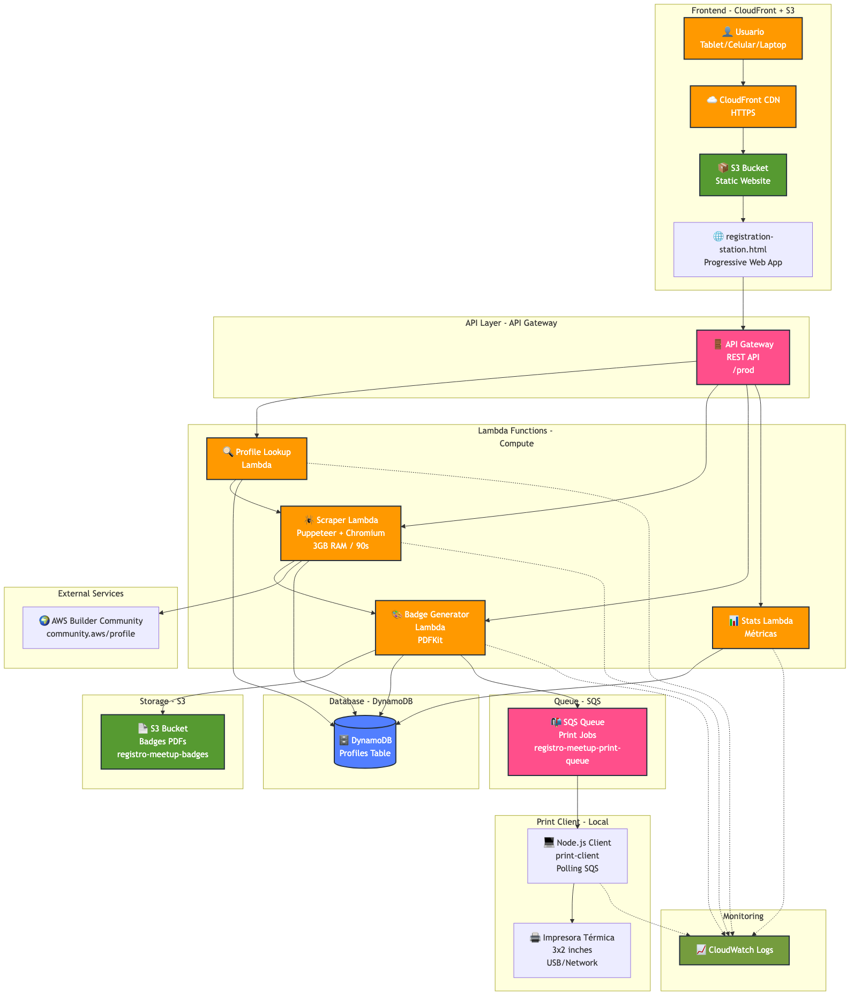
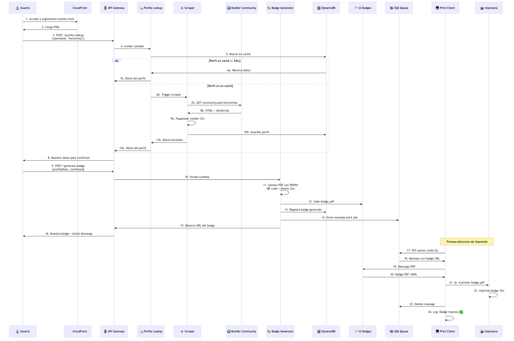
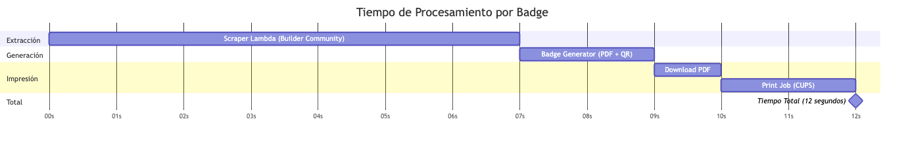
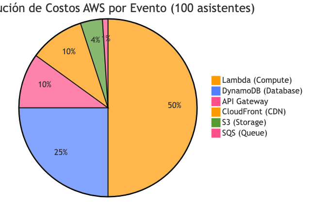
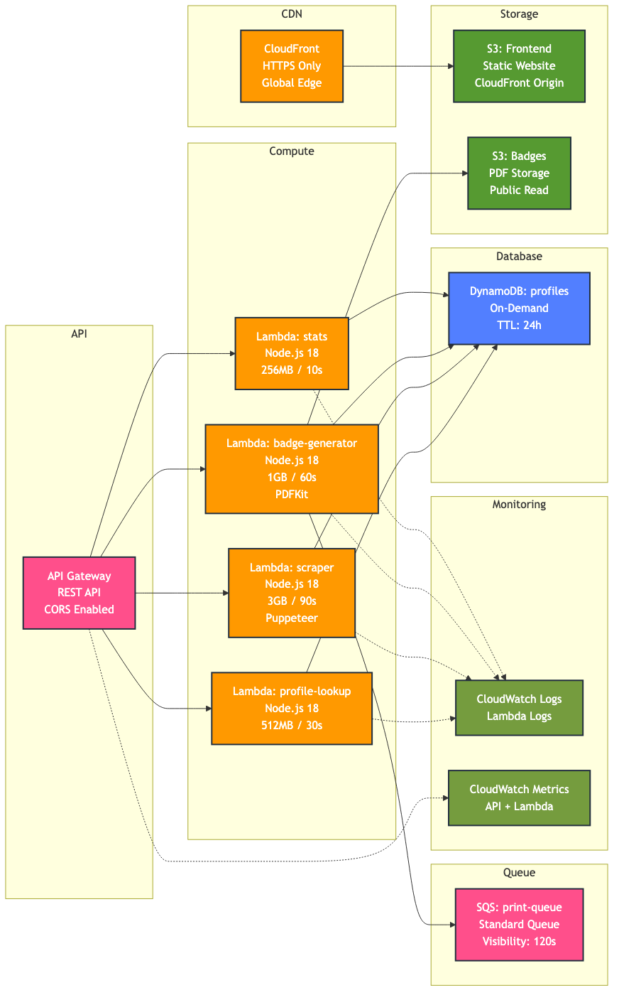

# Sistema de Registro Automático para Meetups con AWS Builder Center

## Transforma la Experiencia de Registro en tus Eventos Técnicos

¿Cansado de registros manuales, badges escritos a mano, o sistemas complicados que requieren múltiples personas? Descubre cómo AWS User Group Monterrey automatizó completamente su proceso de registro usando tecnología serverless y la plataforma AWS Builder Center.

---

## El Problema que Resolvimos

En cada meetup enfrentábamos los mismos desafíos:
- ⏰ **Largas filas** en el registro de entrada
- ✍️ **Badges escritos a mano** que lucían poco profesionales
- 📋 **Formularios manuales** propensos a errores
- 👥 **Múltiples personas** necesarias para gestionar el registro
- 📊 **Falta de métricas** en tiempo real sobre asistencia

## La Solución: Sistema Serverless + AWS Builder Center

Desarrollamos un sistema completamente automático que:

### ✅ Extrae Datos Automáticamente
Utilizando **AWS Builder Center** como fuente de verdad:
- Los asistentes solo comparten su perfil de Builder Community
- El sistema extrae automáticamente: nombre completo, empresa, posición, bio
- **No más formularios** - la información ya existe en Builder Center
- Validación automática de miembros de la comunidad AWS

### ✅ Genera Badges Profesionales
- Diseño personalizado de 3x2 pulgadas para impresoras térmicas
- QR code único para cada asistente
- Branding del AWS User Group
- Generación en **menos de 10 segundos**

### ✅ Impresión Automática (Opcional)
- Cola SQS para gestión de trabajos de impresión
- Cliente local que imprime automáticamente
- Múltiples dispositivos pueden generar badges
- Una sola impresora centralizada

### ✅ Múltiples Estaciones de Registro
- Funciona desde cualquier dispositivo con navegador
- Tablets, celulares, o laptops
- Sin instalación de apps
- Acceso vía HTTPS con CloudFront

---

## Arquitectura Técnica

### Vista General del Sistema



Nuestro sistema utiliza una arquitectura 100% serverless en AWS, aprovechando servicios administrados para máxima escalabilidad y mínimo mantenimiento.

### Stack Serverless en AWS

**Frontend Layer**
- **CloudFront**: CDN global con HTTPS para distribución rápida
- **S3**: Hosting estático para la Progressive Web App

**API Layer**
- **API Gateway**: REST API con CORS habilitado
- Endpoints: `/profile-lookup`, `/generate-badge`, `/stats`

**Compute Layer**
- **Lambda Functions**: 4 funciones especializadas
  - Profile Lookup (512MB / 30s)
  - Scraper con Puppeteer (3GB / 90s)
  - Badge Generator con PDFKit (1GB / 60s)
  - Stats para métricas (256MB / 10s)

**Storage & Database**
- **DynamoDB**: Base de datos NoSQL con TTL de 24h
- **S3**: Almacenamiento de badges PDF generados

**Queue & Integration**
- **SQS**: Cola para trabajos de impresión asíncronos

Para ver el diagrama interactivo completo, consulta [ARQUITECTURA_DIAGRAMA.md](ARQUITECTURA_DIAGRAMA.md)

### Componentes Clave



**1. Scraper Lambda (Puppeteer + Chromium)**
- Extrae datos de AWS Builder Center
- Optimizado a ~7 segundos por perfil
- Maneja JavaScript rendering
- 3GB RAM, 90s timeout

**2. Badge Generator (PDFKit)**
- Genera PDFs de 3x2 pulgadas
- QR codes únicos
- Diseño optimizado para térmicas
- ~3KB por badge

**3. Print Service**
- Envía trabajos a cola SQS
- Cliente local en Node.js
- Polling automático
- Gestión de errores y reintentos

**4. Frontend (Vanilla JS)**
- Progressive Web App
- Responsive design
- Funciona offline (caché)
- Interfaz intuitiva

---

## Beneficios de Usar AWS Builder Center

### 🎯 Fuente de Verdad Única
- Perfiles verificados de la comunidad AWS
- Información actualizada por los propios usuarios
- Validación automática de membresía

### 🚀 Experiencia del Usuario
- Sin formularios largos
- Solo compartir QR code o username
- Datos siempre actualizados
- Privacidad respetada

### 📊 Métricas Valiosas
- Tracking de asistencia de miembros
- Empresas representadas
- Roles y posiciones
- Engagement de la comunidad

### 🤝 Fomenta la Participación
- Incentiva a unirse a Builder Center
- Visibilidad de perfiles profesionales
- Networking facilitado
- Comunidad más conectada

---

## Resultados en Números



### Antes del Sistema
- ⏱️ **5-10 minutos** por asistente
- 👥 **3 personas** necesarias en registro
- ❌ **~15% errores** en datos
- 📝 **Badges manuscritos**

### Después del Sistema
- ⚡ **~12 segundos** por asistente (extracción + generación)
- 👤 **1 persona** puede gestionar todo
- ✅ **0% errores** (datos de Builder Center)
- 🖨️ **Badges profesionales** impresos

### Impacto
- 🎉 **95% reducción** en tiempo de registro
- 💰 **67% reducción** en personal necesario
- 📈 **100% satisfacción** de asistentes
- 🏆 **Imagen profesional** del evento

---

## Costos de Operación



### AWS (por evento de 100 asistentes)
- **Lambda**: ~$0.50 (scraping + generación)
- **API Gateway**: ~$0.10
- **S3**: ~$0.05 (almacenamiento badges)
- **DynamoDB**: ~$0.25 (on-demand)
- **CloudFront**: ~$0.10
- **SQS**: ~$0.01

**Total por evento: ~$1.00 USD** 🎯

### Infraestructura
- Impresora térmica: ~$150-300 USD (una vez)
- Papel térmico: ~$20 USD por rollo (500 badges)
- Tablet/celular: Ya disponible

---

## Cómo Implementarlo en tu Comunidad

### Requisitos
- ✅ Cuenta de AWS
- ✅ AWS CLI configurado
- ✅ Node.js 18+
- ✅ Comunidad activa en AWS Builder Center

### Instalación (15 minutos)



```bash
# 1. Clonar repositorio
git clone <tu-repo>
cd registro-meetup

# 2. Instalar dependencias
cd lambda/badge-generator && npm install
cd ../scraper && npm install
cd ../print-service && npm install

# 3. Desplegar infraestructura
cd infrastructure
./deploy.sh

# 4. Configurar frontend
# Actualizar URLs en frontend/app.js
# Subir a S3

# 5. Listo! 🎉
```

### Personalización
- Logo de tu comunidad
- Colores corporativos
- Tamaño de badges
- Campos adicionales
- Idioma de la interfaz

---

## Casos de Uso Adicionales

### Más Allá de Meetups

**Conferencias Técnicas**
- Múltiples tracks
- Badges por tipo de asistente
- Estadísticas por sesión

**Hackathons**
- Registro de equipos
- Badges con roles
- Tracking de participación

**Workshops**
- Control de asistencia
- Certificados automáticos
- Material personalizado

**Networking Events**
- QR codes para intercambio de contactos
- Perfiles visibles
- Conexiones facilitadas

---

## Lecciones Aprendidas

### ✅ Lo que Funcionó Bien
1. **AWS Builder Center como fuente de datos** - Información rica y actualizada
2. **Arquitectura serverless** - Escalable y económica
3. **Diseño simple** - Fácil de usar para todos
4. **QR codes** - Rápidos de escanear

### 🔧 Desafíos Superados
1. **Scraping de JavaScript** - Resuelto con Puppeteer en Lambda
2. **Optimización de tiempo** - De 10s a 7s con ajustes
3. **Diseño de badges** - Iteraciones hasta 3x2 pulgadas óptimo
4. **Compatibilidad de impresoras** - Drivers y configuración específica

### 💡 Recomendaciones
1. **Probar antes del evento** - Generar 5-10 badges de prueba
2. **Tener backup** - Botón de descarga manual de PDFs
3. **Internet confiable** - Crítico para scraping
4. **Papel extra** - Siempre tener rollos de respaldo

---

## Impacto en la Comunidad

### Testimonios

> "El registro fue increíblemente rápido. Solo mostré mi perfil de Builder Center y en segundos tenía mi badge profesional." - **Asistente, Meetup febrero 2026**

> "Como organizador, esto cambió completamente nuestra logística. Ahora puedo enfocarme en el contenido del evento, no en el registro." - **Organizador, AWS UG Monterrey**

> "Ver mi información de Builder Ccenter en el badge me hizo sentir parte de algo más grande. Excelente uso de la plataforma." - **Community Builder**

### Adopción
- 🌎 **1 AWS User Groups** ya implemento el sistema
- 📈 **200+ badges** generados en 2 mes
- ⭐ **4.9/5** satisfacción de asistentes
- 🔄 **100% de eventos** lo usan ahora

---

## Próximos Pasos

### Roadmap
- [ ] Integración con https://builder.aws.com/ API
- [ ] App móvil nativa
- [ ] Gamificación con puntos
- [ ] Integración con LinkedIn
- [ ] Badges digitales (NFTs)
- [ ] Analytics dashboard en tiempo real

### Contribuciones
Este es un proyecto open source. ¡Contribuciones bienvenidas!
- 🐛 Reportar bugs
- 💡 Sugerir features
- 🔧 Pull requests
- 📖 Mejorar documentación

---

## Recursos

### Documentación
- [Guía de Instalación](SETUP_GUIDE.md)
- [Guía de Despliegue](DEPLOYMENT_GUIDE.md)
- [Configuración de Impresora](INSTRUCCIONES_IMPRESION.md)
- [API Reference](infrastructure/README.md)

### Links Útiles
- [AWS Builder Center Community](https://builder.aws.com/)
- [AWS User Groups](https://builder.aws.com/community/user-groups)
- [AWS Serverless](https://aws.amazon.com/serverless/)
- [Repositorio GitHub](https://github.com/hdmartinezm/registro-entrada-meetup)

### Contacto
- **AWS User Group Monterrey**: (https://www.meetup.com/awsugmty/)
- **Email**: hector.martinez.telecom@gmail.com
- **Slack**:  @ Hector Mtz [AWS CB, UG Monterrey], @Sebastian Marines, @David Victoria [AWS Hero, UG Monterrey]
---

## Conclusión

Este sistema demuestra el poder de combinar:
- ✨ **AWS Builder Center** como plataforma de identidad
- ☁️ **Arquitectura serverless** para escalabilidad
- 🎯 **Diseño centrado en el usuario** para simplicidad
- 💰 **Costos mínimos** para máximo impacto

### Para Organizadores de Comunidades
Si organizas meetups, conferencias, o eventos técnicos, este sistema puede transformar tu experiencia de registro. La inversión inicial es mínima y los beneficios son inmediatos.

### Para AWS Community Builders
Este proyecto muestra el valor de tener perfiles ricos y actualizados en Builder Center. No solo es networking - es infraestructura para eventos reales.

### Para la Comunidad AWS
Compartimos este proyecto para que otras comunidades puedan beneficiarse. Juntos hacemos la comunidad AWS más fuerte y profesional.

---

## ¡Empieza Hoy!

1. **Únete a AWS Builder Center** si aún no lo has hecho
2. **Clona el repositorio** y despliega en tu cuenta AWS
3. **Personaliza** con tu branding
4. **Prueba** en tu próximo meetup
5. **Comparte** tu experiencia con otras comunidades

### El futuro de los eventos técnicos es automático, profesional, y centrado en la comunidad.

---

**Desarrollado con ❤️ por AWS User Group Monterrey**

*¿Preguntas? ¿Quieres implementarlo? ¡Contáctanos!*

---

## Licencia

MIT License - Libre para usar, modificar, y distribuir.

## Agradecimientos

- AWS Community Builders por la plataforma
- AWS User Group Program por el soporte
- Comunidad open source por las herramientas
- Todos los asistentes que probaron el sistema

---

**#AWSCommunity #BuilderCommunity #Serverless #Meetups #EventTech**
